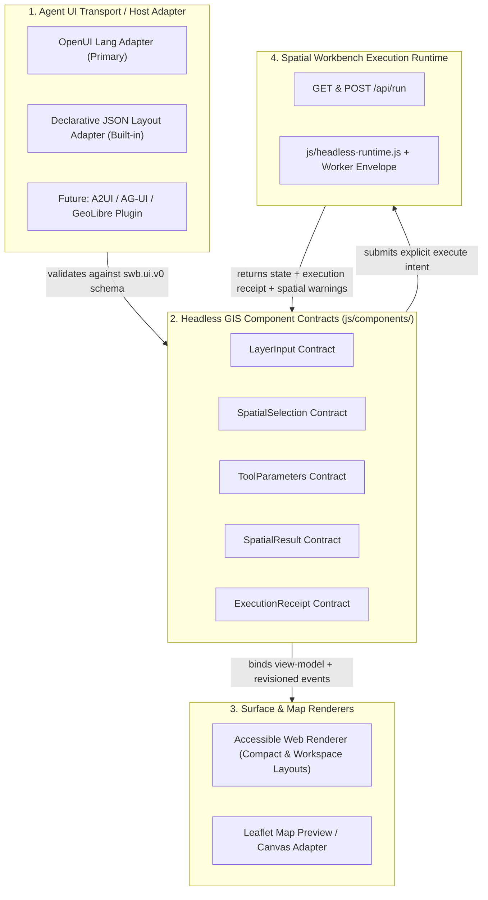

# Opinionated GIS Components for Agent-Generated Interfaces

> **Core Thesis:** *Agents compose the interface. Components collect precise intent. Spatial Workbench executes the operation. Users can inspect and refine the result.*

This document captures the architecture decision, component contracts (`swb.ui.v0`), opinionated GIS standards, ecosystem evaluation, prototype specification, and implementation roadmap for [Issue #152](https://github.com/danmaps/Spatial-Workbench/issues/152).

---

## 1. Codebase Inventory: Reuse and Extraction Points

Spatial Workbench already provides deterministic spatial execution (`POST /api/run`), canonical layer identity (`js/state.js`), selection-aware targeting (`js/tools/targeting.js`), and spatial validation (`js/spatial.js`). The table below maps each v0 component to existing modules and identifies the extraction points for `js/components/`.

| Component | Existing Module(s) | What Already Works | Extraction / Hardening Needed |
| :--- | :--- | :--- | :--- |
| **`LayerInput`** | `js/state.js` (`getLayerInfo`, `listLayers`), `js/runtime/executionSpec.js` (`validateExecutionSpec`) | Canonical layer summary (`id`, `displayName`, `geometry.type`, `geometry.featureCount`, `source.kind`); machine-readable `execution.inputs[].geometryTypes` filtering. | Extract a pure `filterCompatibleLayers(layers, inputSpec)` helper from `executionSpec.js` so `LayerInput` can flag or disable incompatible geometry layers prior to execution. |
| **`SpatialSelection`** | `js/state.js` (`_selectionState`), `js/tools/targeting.js` (`resolveTargetLayerData`), `js/ui/map-interaction-mode.js` | `BufferTool`, `ExportTool`, `GroupTool`, `ClipTool`, and `EraseTool` declare `selectionAware: true` and filter by `state.selection.selectedFeaturesByLayerId` in both browser and headless modes. | Formalize explicit `targetScope` (`"layer" \| "selection"`) in `resolveTargetLayerData()` so that an empty selection when `targetScope === "selection"` blocks execution with `mode: "selection-empty"` rather than silently running on the full layer. |
| **`ToolParameters`** | `js/tools/specs.json`, `js/models/Tool.js` (`getSpec`, `renderUI`, `collectParamsFromDOM`, `validateParameters`), `js/models/Parameter.js` | Declarative parameter definitions (`dropdown`, `int`, `float`, `boolean`, `text`, `file`), `min`/`max`/`options`/`required`, and value preservation across re-renders. | Extract a DOM-independent draft parameter controller (`createToolParameterDraft(spec, initialValues)`) from `Tool.renderUI()` and share declarative `validateParameters()` across browser UI, headless runtime, and component contracts. |
| **`SpatialResult`** | `js/ui/attribute-view.js` (`getAttributeModel`), `js/app.js` (Leaflet canvas), `js/ui/selection-style.js` | `getAttributeModel()` is a pure, DOM-free view-model generator supporting `all` vs. `selected` modes, row caps (`maxRows: 25`), and mobile card vs. desktop grid views. | Pair `getAttributeModel()` with a lightweight map preview adapter interface (`renderLayers(container, layers, selection, options)`) usable in both compact embedded cards and split workspace layouts. |
| **`ExecutionReceipt`** | `server.js` (`buildExecutionMetadata`), `js/spatial.js` (`SPATIAL_METADATA`, warnings), `public/js/headless-demo-client.js` (`createReceiptCard`) | `POST /api/run` returns `execution` (`startedAt`, `finishedAt`, `durationMs`, `inputLayerIds`, `outputLayerIds`, `featureCounts`, `target`, `datasetHandles`), `spatial` (`crs`, `precision`, `warnings`), and `output.artifacts`. | Extract `createReceiptCard` into a reusable `ExecutionReceipt` view-model surfacing CRS assumptions (`EPSG:4326`, `not-survey-grade`), target scope (`layer` vs. `selection`), warnings, and artifact downloads. |

---

## 2. Architecture Decision Record (ADR): Layered Component Seam

### Context
External agents (OpenUI streams, MCP-connected clients, or custom web hosts) need to dynamically assemble spatial user interfaces without re-inventing GIS interaction rules (units, geometry constraints, selection scope, EPSG:4326 measurement caveats, or provenance receipts). At the same time, Spatial Workbench must remain a dependable execution engine (`docs/execution-engine-reframing.md`) rather than becoming a monolithic agent framework.

### Decision
Separate the interaction layer into **four distinct seams**:



1. **Contract Layer (`js/components/contracts.js`):** Pure JavaScript/JSON Schema definitions, lifecycle state validators (`loading | empty | draft | invalid | running | partial | failed | completed`), and view-model builders. Requires zero DOM, React, or Leaflet globals.
2. **State & Revision Coordinator (`js/components/session.js`):** Wraps the serialized `{ layers, bbox, selection }` state envelope with a monotonically increasing `stateRevision` integer. Every user parameter edit or selection change increments `stateRevision`. Late-arriving agent responses referencing an older `stateRevision` cannot silently overwrite newer user selections or execute stale parameters.
3. **Renderer Layer (`js/components/renderers.js`):** Maps component view-models to accessible DOM elements (supporting both **Compact Conversational Card** and **Expanded Review Workspace** layouts) and delegates map rendering to a pluggable map preview adapter (starting with Leaflet).
4. **Agent UI Framework Adapter (`js/components/adapters/`):** Translates an external generative-UI representation (such as OpenUI Lang component expressions or a JSON layout descriptor) into registered Spatial Workbench components.

---

## 3. v0 Component Schemas and User-Event Contracts (`swb.ui.v0`)

### 3.1 Shared Lifecycle and Revision Envelope
Every component instance carries a common contract version, revision number, and lifecycle status:

```json
{
  "contractVersion": "swb.ui.v0",
  "stateRevision": 4,
  "streamComplete": true,
  "lifecycle": "draft",
  "lifecycleAllowed": [
    "loading",
    "empty",
    "draft",
    "invalid",
    "running",
    "partial",
    "failed",
    "completed"
  ]
}
```

* **Streaming Guardrail:** While an agent response is still streaming (`streamComplete: false`), components mount in `loading` or `draft` state with execution disabled. Incomplete streamed UI descriptions never execute tools.

### 3.2 v0 Component Catalog Schemas

#### 1. `LayerInput`
Chooses a compatible input layer and declares whether execution targets the whole layer or selected features.
* **Props:**
  * `componentId` (`string`, required)
  * `toolKey` (`string`, required — e.g. `"BufferTool"`)
  * `parameterName` (`string`, required — e.g. `"Input Layer"`)
  * `selectedLayerId` (`string | null`)
  * `allowedGeometryTypes` (`string[]` — derived from `spec.execution.inputs[].geometryTypes`)
  * `targetScope` (`"layer" | "selection"`, default `"layer"`)
* **Structured Output:**
  ```json
  {
    "layerId": "parcels-1",
    "displayName": "Study Parcels",
    "geometryType": "Polygon",
    "featureCount": 3,
    "compatible": true,
    "targetScope": "selection",
    "selectedFeatureCount": 2
  }
  ```

#### 2. `SpatialSelection`
Inspects or updates the selected feature subset for a layer.
* **Props:**
  * `componentId` (`string`, required)
  * `layerId` (`string`, required)
  * `mode` (`"layer" | "selected_features" | "drawn_aoi"`, default `"selected_features"`)
  * `selectedFeatureIds` (`string[]`)
  * `emptySelectionPolicy` (`"block" | "fallback_to_layer"`, default `"block"` when mode is `"selected_features"`)
* **Structured Output:**
  ```json
  {
    "layerId": "parcels-1",
    "mode": "selected_features",
    "selectedFeatureIds": ["parcels-1-1", "parcels-1-3"],
    "effectiveFeatureCount": 2,
    "totalFeatureCount": 3,
    "valid": true
  }
  ```

#### 3. `ToolParameters`
Presents editable inputs derived from the runtime tool schema (`GET /api/run`).
* **Props:**
  * `componentId` (`string`, required)
  * `toolKey` (`string`, required)
  * `draftParams` (`Record<string, string | number | boolean>`)
  * `lockedParams` (`string[]`, optional — e.g. parameters bound to `LayerInput`)
  * `showSpatialAssumptions` (`boolean`, default `true`)
* **Structured Output:**
  ```json
  {
    "toolKey": "BufferTool",
    "params": {
      "Input Layer": "parcels-1",
      "Distance": 500,
      "Units": "meters"
    },
    "isDirty": true,
    "validation": {
      "ok": true,
      "errors": []
    }
  }
  ```

#### 4. `SpatialResult`
Inspects output geometry on a map preview alongside linked feature attributes (`getAttributeModel`).
* **Props:**
  * `componentId` (`string`, required)
  * `layerIds` (`string[]`, required — e.g. `["parcels-1", "result-1"]`)
  * `primaryOutputLayerId` (`string`, required)
  * `attributeMode` (`"all" | "selected"`, default `"all"`)
  * `surfaceVariant` (`"compact" | "workspace"`, default `"compact"`)
* **Structured Output:**
  ```json
  {
    "primaryOutputLayerId": "result-1",
    "visibleLayerIds": ["parcels-1", "result-1"],
    "focusedFeatureId": "result-1-1",
    "attributeSummary": {
      "totalRows": 2,
      "columns": ["name", "area_sqm"]
    }
  }
  ```

#### 5. `ExecutionReceipt`
Explains what ran and what happened using the grounded response from `POST /api/run`.
* **Props:**
  * `componentId` (`string`, required)
  * `toolKey` (`string`, required)
  * `status` (`{ code: number, message: string }`)
  * `execution` (`{ startedAt, finishedAt, durationMs, inputLayerIds, outputLayerIds, featureCounts, target, datasetHandles }`)
  * `spatial` (`{ crs, coordinateOrder, engine, measurementModel, precision, warnings }`)
  * `artifacts` (`Array<{ type: "download", filename: string, mimeType: string, data: string }>`)
  * `canRerun` (`boolean`, default `true`)

### 3.3 User-Event Contract
All user actions emit a revision-bound event envelope:

```json
{
  "contractVersion": "swb.ui.v0",
  "eventType": "swb:execute-requested",
  "componentId": "buffer-params-1",
  "stateRevision": 5,
  "timestamp": "2026-11-22T06:00:00.000Z",
  "payload": {
    "tool": "BufferTool",
    "params": {
      "Input Layer": "parcels-1",
      "Distance": 500,
      "Units": "meters",
      "targetScope": "selection"
    }
  }
}
```

Supported v0 event types:
1. `swb:layer-selected` — User changed the target input layer or `targetScope` (`"layer" | "selection"`).
2. `swb:selection-changed` — User toggled selected features in the map or attribute view.
3. `swb:params-draft-changed` — User edited a parameter value (updates draft state, increments `stateRevision`, validates against tool schema, does **not** auto-execute).
4. `swb:execute-requested` — User clicked the explicit **Execute / Rerun** action on a valid draft.
5. `swb:artifact-download` — User triggered a download for an artifact returned by `ExportTool`.

---

## 4. Opinionated Standards and Runtime Coverage

1. **One tool contract:** `Tool.prototype.getSpec()`, `specs.json`, `Tool.prototype.validateParameters()`, and `ToolParameters` share a single parameter definition (`type`, `defaultValue`, `options`, `min`, `max`, `required`). Presentation hints never alter runtime semantics.
2. **Explicit spatial semantics:** Every parameter form and receipt surfaces units, geometry constraints, and `SPATIAL_METADATA` (`EPSG:4326`, `longitude,latitude`, `@turf/turf`, `not-survey-grade`). Coordinate and geometry warnings from `js/spatial.js` are carried through unmodified.
3. **Selection is data:** Analysis scope (`targetScope: "layer" | "selection"`) is explicit. When `targetScope === "selection"` and 0 features are selected, validation fails with `"No selected features in the chosen layer."` rather than silently running on the whole layer. Map panning never alters analysis scope.
4. **Stable identity and state ownership:** Layer IDs (`__id`), dataset IDs (`__datasetId`), and feature IDs (`ensureFeatureId`) persist across tool runs. User edits bind to `stateRevision` so late agent responses cannot overwrite newer user state.
5. **Predictable execution:** Agent proposals and user edits update a `draft`. Only an explicit user action transitions `draft -> running -> completed`.
6. **Grounded results:** `ExecutionReceipt` and `SpatialResult` populate exclusively from actual `POST /api/run` responses (`status`, `execution`, `spatial.warnings`, `output.artifacts`), including `execution.target` (`mode`, `selectedFeatureCount`, `totalFeatureCount`).
7. **Inspectable and reversible interaction:** Derived outputs record `parentLayerId` and `toolHistory` while keeping source layers intact, allowing users to adjust parameters and rerun against the original source layer.
8. **Bounded composition:** Agents may only compose registered components from the `swb.ui.v0` catalog and bind them to supported tools in `getHeadlessToolCatalog()`. Incomplete streamed definitions (`streamComplete: false`) cannot execute tools.
9. **Accessible defaults:** All controls provide explicit `<label>` bindings, keyboard operability, explicit unit labels, non-color-only status badges, and small-screen stacked-card fallbacks (`getAttributeModel`).
10. **Versioned interoperability:** All component props and events declare `contractVersion: "swb.ui.v0"`. Unknown component names or incompatible contract versions render a deterministic fallback card.

---

## 5. Ecosystem Comparison: OpenUI vs. GeoLibre

| Dimension | OpenUI (`@openuidev/react-lang` / OpenUI Lang) | GeoLibre (`opengeos/GeoLibre`) |
| :--- | :--- | :--- |
| **Core Purpose** | Generative UI streaming language and component registration framework (`defineComponent`, `createLibrary`, progressive streaming parser, system prompt compilation). | Cross-platform cloud-native GIS application host built on React, TypeScript, MapLibre GL JS, Tauri, and Zustand (`GeoLibrePlugin` / `GeoLibreAppAPI`). |
| **Integration Seam** | Agent streams compact OpenUI Lang expressions referencing registered Spatial Workbench components (`LayerInput`, `ToolParameters`, `SpatialResult`, `ExecutionReceipt`). | Spatial Workbench headless runtime or components can be packaged as a `GeoLibrePlugin` injecting into GeoLibre's sidebar and syncing layers with GeoLibre's Zustand store. |
| **Coupling & Footprint** | **Low.** Does not impose a competing GIS engine or map state store. | **High.** Brings its own MapLibre GL JS lifecycle, Zustand store, and built-in Turf/WASM processing plugins. |

### Recommendation
* **Initial Host & Adapter:** Implement the v0 component contracts and renderers directly in Spatial Workbench (`js/components/`) and provide an **OpenUI catalog adapter** as the primary generative-UI integration path.
* **Initial Map Renderer:** Use Spatial Workbench's existing **Leaflet + `attribute-view.js`** stack behind a clean map-preview adapter seam.
* **GeoLibre Path:** Treat GeoLibre as a future downstream host plugin target once the `swb.ui.v0` contract is proven in Spatial Workbench.

---

## 6. Smallest Prototype: `BufferTool -> ExportTool`

* **Fixture:** Fixed `EPSG:4326` GeoJSON layer (`study-sites`, 3 features, with 2 features selected).
* **Prompt Scenario:** *"Buffer these features by 500 meters and let me inspect and export the result."*
* **Workflow:**
  1. Agent composes `LayerInput`, `SpatialSelection`, `ToolParameters` (`BufferTool`, `Distance: 500`, `Units: "meters"`), `SpatialResult`, and `ExecutionReceipt`.
  2. User inspects or edits the distance/units/selection scope (`Whole Layer` vs. `Selected Features`).
  3. Clicking **Run Buffer** submits the validated parameters and serialized state to `POST /api/run`.
  4. `SpatialResult` renders the preserved input layer alongside the buffered output layer and attribute cards/rows; `ExecutionReceipt` displays duration, feature counts (`2 -> 2`), `target.mode` (`selection`), and `EPSG:4326` assumptions.
  5. User changes `Distance` (e.g. `500 -> 750`) and reruns against the preserved source layer.
  6. Clicking **Export GeoJSON** invokes `ExportTool` via `POST /api/run` and downloads the resulting artifact with full `toolHistory` lineage.
* **Two Agent-Composed Layouts:**
  * **Layout A (Compact Conversational Card):** Inline single-column card stack designed for chat/assistant responses and mobile viewports.
  * **Layout B (Expanded Review Workspace):** Two-column split workspace with persistent selection checklist, parameter controls, and receipt timeline on the left, and an expanded map canvas + attribute drawer on the right.

---

## 7. Follow-Up Implementation Issues

Implementation is split into five small, reviewable issues:

1. **[#160](https://github.com/danmaps/Spatial-Workbench/issues/160)** *(Completed)* — Harden parameter contracts (`required`, base schema validation, UI Execute button gating for [#4](https://github.com/danmaps/Spatial-Workbench/issues/4)), add `"meters"` units to `BufferTool` and `GroupTool`, enforce explicit `targetScope` (`"layer" | "selection"`), and surface `target` metadata in `POST /api/run` `execution` receipts.
2. **[#161](https://github.com/danmaps/Spatial-Workbench/issues/161)** *(Completed)* — Implement headless v0 GIS component contracts (`swb.ui.v0`), `filterCompatibleLayers()`, bounded component registry, and revisioned session store (`js/components/contracts.js`, `js/components/session.js`).
3. **[#162](https://github.com/danmaps/Spatial-Workbench/issues/162)** — Implement accessible DOM + Leaflet renderers for the v0 GIS component catalog (`js/components/renderers.js`).
4. **[#163](https://github.com/danmaps/Spatial-Workbench/issues/163)** — Add OpenUI / declarative layout adapter and dual-layout `/agent-ui-demo` prototype (`BufferTool -> ExportTool`).
5. **[#164](https://github.com/danmaps/Spatial-Workbench/issues/164)** — Add end-to-end equivalence, revision-safety, and accessibility tests for v0 GIS components.
