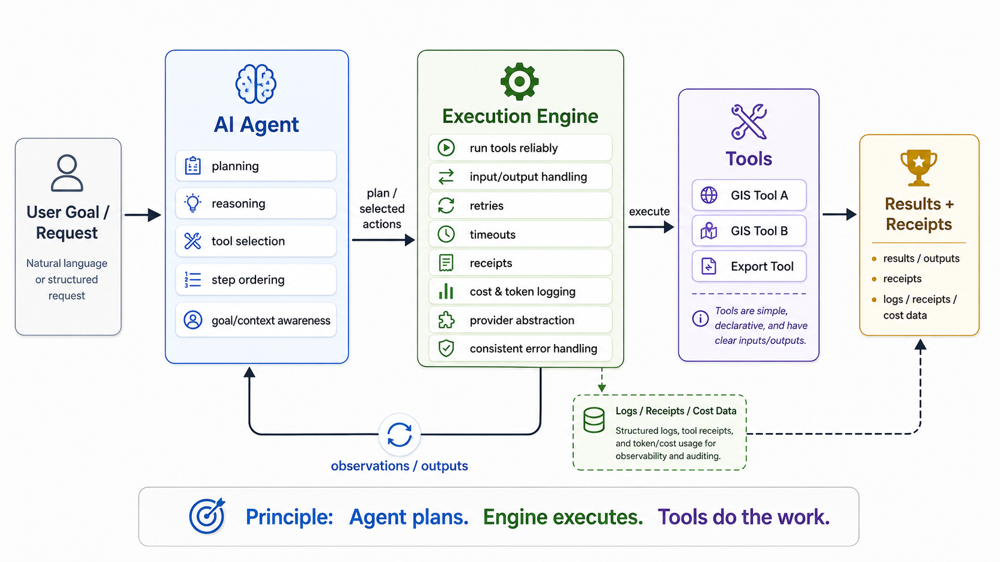
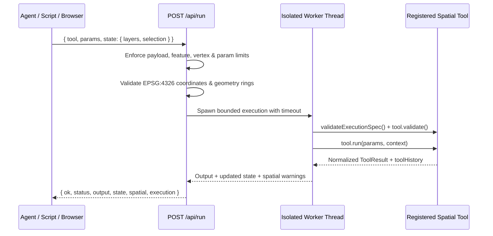
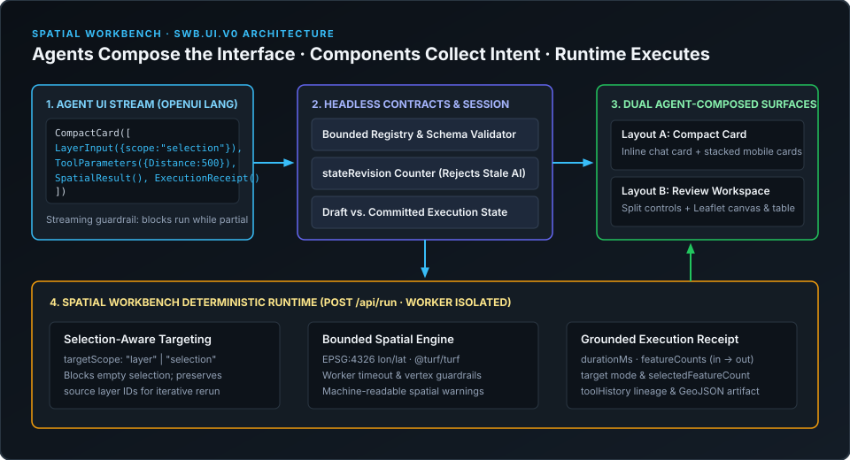
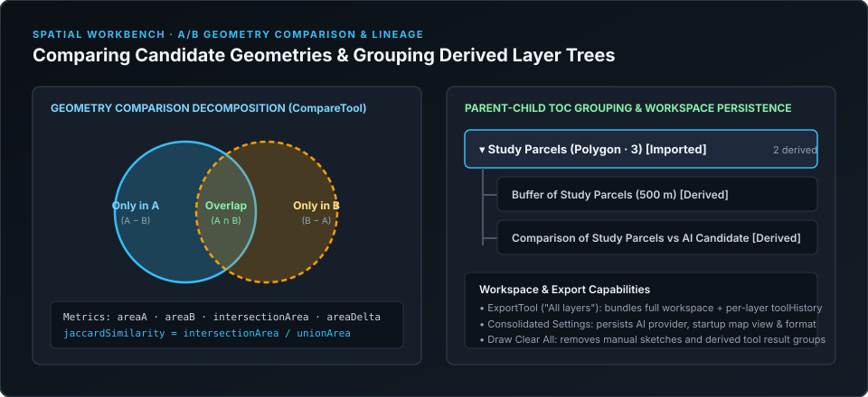

# Spatial Workbench Feature Profiles: Vision, Purpose, and Implementation

Spatial Workbench sits in the gap between heavyweight desktop GIS suites and fragile web-mapping toys. Its guiding thesis is simple:

> **Agent plans. Engine executes. Tools do the work. Nothing is hidden.**

This document profiles the core capabilities of Spatial Workbench in a deep-dive, blog-post format—explaining **why each capability exists (Vision & Purpose)**, **how it works under the hood (Implementation)**, and **how to use or extend it (Code Samples & Diagrams)**.

---

## Profile 1: The Deterministic Spatial Execution Engine



### The Vision & Purpose
Most AI agents struggle with spatial reasoning when asked to invent raw coordinate math in token space. Conversely, traditional GIS platforms are too stateful and UI-bound for an external agent or script to call reliably.

Spatial Workbench solves this by treating every spatial operation as a **request-scoped, worker-isolated, contract-first service** exposed through `POST /api/run` (and mirrored via CLI and MCP). The caller owns planning and session orchestration; Spatial Workbench guarantees deterministic validation, bounded execution, explicit coordinate assumptions (`EPSG:4326`, `@turf/turf`, `not-survey-grade`), and a machine-readable **execution receipt**.



### Implementation Highlights
* **Declarative Tool Contracts (`js/models/Tool.js`, `js/models/Parameter.js`):** Every tool declares its parameters (`type`, `defaultValue`, `options`, `min`, `max`, `required`, `unit`) and an `execution` specification (`stateMode`, `inputs`, `outputs`, `mutatesState`, `producesArtifacts`).
* **Worker Isolation & Guardrails (`server.js`, `js/runtime/workerExecutor.js`):** Each `POST /api/run` call runs inside an interruptible Node worker thread with configurable limits on request bytes, layer/feature/vertex counts, concurrency, and wall-clock timeout.
* **Spatial Honesty Layer (`js/spatial.js`):** Incoming coordinates are inspected for reversed latitude/longitude or projected-looking coordinates (`> 180°`). Suspicious or null geometries emit structured warnings (`spatial.warnings`) rather than failing silently.

### Code Sample: Chaining Headless Spatial Operations

```js
// 1. Run a 500-meter buffer on selected features via POST /api/run
const bufferResponse = await fetch('https://workbench.dannymcvey.com/api/run', {
  method: 'POST',
  headers: { 'Content-Type': 'application/json' },
  body: JSON.stringify({
    tool: 'BufferTool',
    params: {
      'Input Layer': 'study-sites',
      Distance: 500,
      Units: 'meters',
      targetScope: 'selection',
    },
    state: {
      layers: [studySitesLayer],
      selection: {
        activeLayerId: 'study-sites',
        selectedFeaturesByLayerId: {
          'study-sites': ['study-sites-1', 'study-sites-2'],
        },
        targetScope: 'selection',
      },
    },
  }),
}).then((r) => r.json());

// 2. Inspect the grounded receipt
console.log(bufferResponse.execution);
// {
//   startedAt: "2026-11-22T06:00:00.000Z",
//   finishedAt: "2026-11-22T06:00:00.008Z",
//   durationMs: 8,
//   inputLayerIds: ["study-sites"],
//   outputLayerIds: ["result-1"],
//   featureCounts: { input: 2, output: 2 },
//   target: {
//     layerId: "study-sites",
//     mode: "selection",
//     selectedFeatureIds: ["study-sites-1", "study-sites-2"],
//     selectedFeatureCount: 2,
//     totalFeatureCount: 3
//   }
// }
```

---

## Profile 2: Opinionated GIS Components for Agent-Generated Interfaces (`swb.ui.v0`)



### The Vision & Purpose
When an AI agent builds a user interface dynamically (via generative UI frameworks like **OpenUI**), a raw form generator is not enough for GIS. Spatial operations have domain-specific pitfalls:
* Which layers have compatible geometry types for `ClipTool` vs. `BufferTool`?
* Is the operation going to run on the whole layer or only the 2 highlighted features on the map?
* What happens if the user edits a distance parameter while the LLM is still streaming tokens?
* Can an unexecuted AI proposal accidentally look like a completed spatial analysis?

The **`swb.ui.v0` component catalog** (`js/components/`) provides five opinionated, reusable building blocks—`LayerInput`, `SpatialSelection`, `ToolParameters`, `SpatialResult`, and `ExecutionReceipt`—that let an agent compose either a compact inline card or a full split review workspace while guaranteeing GIS correctness.

### Implementation Highlights
1. **Single Runtime Contract (`js/components/contracts.js`):** `ToolParameters` and `LayerInput` derive their controls, unit dropdowns, and geometry compatibility checks (`filterCompatibleLayers`) directly from the runtime tool catalog (`GET /api/run`).
2. **Revisioned Session Store (`js/components/session.js`):** Every user selection or parameter edit increments a monotonically increasing `stateRevision`. Late agent stream updates carrying an older `baseRevision` are deterministically rejected (`reason: 'stale-revision'`) so an agent never clobbers a user's manual adjustment.
3. **Streaming Guardrails (`js/components/adapters/openui.js`):** `parseOpenUILang()` progressively parses `CompactCard([...])` and `ReviewWorkspace([...])` expressions. While `streamComplete` is `false`, components mount in `loading` state with `canExecute: false`.
4. **Reversible Rerun on Preserved Source Layers:** Derived outputs record `parentLayerId`. When a user tweaks `Distance` from `500` to `250` meters and clicks **Rerun**, the session targets the preserved source layer (`study-sites`) and cleanly replaces the intermediate derived output layer.

### Code Sample: Composing Dual Layouts with OpenUI Lang

```js
const { createPrototypeController } = require('./js/components/prototype');

// Mount the OpenUI-driven prototype controller
const controller = createPrototypeController({
  container: document.getElementById('compositionHost'),
  initialLayout: 'compact', // or 'workspace'
});

// Switch between Compact Conversational Card and Expanded Review Workspace
// without losing stateRevision, user draft edits, or execution receipts:
controller.setLayout('workspace');
```

An agent streams compact OpenUI Lang expressions that map 1:1 to registered `swb.ui.v0` components:

```text
ReviewWorkspace([
  LayerInput({ componentId: "proto-layer-input", toolKey: "BufferTool", parameterName: "Input Layer", selectedLayerId: "study-sites", targetScope: "selection" }),
  SpatialSelection({ componentId: "proto-selection", layerId: "study-sites", mode: "selected_features", emptySelectionPolicy: "block" }),
  ToolParameters({ componentId: "proto-buffer-params", toolKey: "BufferTool", lockedParams: ["Input Layer"], draftParams: { "Input Layer": "study-sites", Distance: 500, Units: "meters" } }),
  ExecutionReceipt({ componentId: "proto-receipt", toolKey: "BufferTool" }),
  SpatialResult({ componentId: "proto-spatial-result", surfaceVariant: "workspace" })
])
```

---

## Profile 3: A/B Geometry Comparison & Parent-Child Lineage Grouping



### The Vision & Purpose
A core workflow in human + AI spatial collaboration is **comparing two candidate geometries**:
* How does an AI-generated polygon compare against a human-drawn parcel boundary?
* How much area changed between Scenario A (250m buffer) and Scenario B (500m buffer)?

At the same time, as users run multi-step workflows (`Import -> Buffer -> Clip -> Compare`), a flat Table of Contents (TOC) quickly becomes noisy. Grouping derived layers beneath their parent source layer keeps lineage visually obvious without hiding state.

### Implementation Highlights
* **A/B Geometry Comparison (`js/tools/CompareTool.js`):**
  * Accepts **Layer A** and **Layer B** (honoring selected features via `resolveTargetLayerData`) and computes three distinct spatial components in a single comparison output layer:
    * `intersection` ($A \cap B$ — shared overlap)
    * `only-in-a` ($A - B$ — area present only in Layer A)
    * `only-in-b` ($B - A$ — area present only in Layer B)
  * Computes deterministic comparison metrics using `@turf/turf`: `areaASqm`, `areaBSqm`, `intersectionAreaSqm`, `onlyInAAreaSqm`, `onlyInBAreaSqm`, `areaDeltaSqm` ($B - A$), and `jaccardSimilarity` ($\frac{\text{Area}(A \cap B)}{\text{Area}(A \cup B)}$), attaching them to both the output features and `toolMetadata.comparison`.
* **Parent-Child TOC Result Grouping (`js/state.js`, `js/app.js`):**
  * `state.js` tracks `source.parentLayerId` and `getChildLayerIds(parentId)`.
  * The TOC organizes derived layers into collapsible parent-child groups under their root source layer while keeping per-layer visibility toggles, zoom, properties, and provenance inspection accessible.
* **Full-Workspace Export & Clean Reset (`js/tools/ExportTool.js`, `js/app.js`):**
  * `ExportTool` supports exporting a single layer, a feature selection, or **`"All layers"` (`__all__`)**—bundling every workspace layer into a portable GeoJSON `FeatureCollection` annotated with `__layerId`, `__layerName`, and `toolHistory`.
  * Leaflet Draw's **Clear All** (`draw:deleted`) synchronizes through `state.removeLayer()` so derived `L.GeoJSON` group layers and manual sketches are cleared together without orphaned results.

### Code Sample: Running `CompareTool` Headlessly

```js
const { runHeadlessTool } = require('./js/headless-runtime');

const comparison = await runHeadlessTool({
  tool: 'CompareTool',
  params: {
    'Layer A': 'human-parcel',
    'Layer B': 'ai-candidate',
  },
  state: {
    layers: [humanParcelLayer, aiCandidateLayer],
  },
});

console.log(comparison.output.comparison);
// {
//   areaASqm: 12450.2,
//   areaBSqm: 13100.8,
//   intersectionAreaSqm: 11200.5,
//   onlyInAAreaSqm: 1249.7,
//   onlyInBAreaSqm: 1900.3,
//   areaDeltaSqm: 650.6,
//   jaccardSimilarity: 0.7805,
//   componentCounts: { intersection: 1, onlyInA: 1, onlyInB: 1 }
// }
```

---

## Profile 4: Consolidated Persisted Workspace Settings & BYOK AI

### The Vision & Purpose
A spatial workbench should feel like a durable working environment rather than a stateless demo that resets every time you refresh the browser. At the same time, user API keys must remain 100% client-owned (Bring Your Own Key) and never be persisted on the server.

### Implementation Highlights
* **Consolidated Settings Surface (`js/ui/ai-settings.js`, `js/app.js`):**
  * Unifies **AI Provider & Model Configuration** (OpenRouter, OpenAI, local Ollama), **Map Startup Defaults** (default center latitude/longitude, zoom level, and basemap style), and **Data Defaults** (default export format and TOC grouping behavior) in a single persisted Settings panel.
  * Persists preferences across sessions via `localStorage` and synchronized browser cookies so startup map views and tool defaults apply immediately on load.
* **Privacy-Safe Operational Telemetry (`js/ai/usageTelemetry.js`):**
  * When an AI-backed tool (`AddAIGeneratedFieldTool` or `GenerateAIFeatures`) executes, the runtime records provider, model, token counts, latency, and estimated cost without ever logging user prompts, API keys, or model completions.
